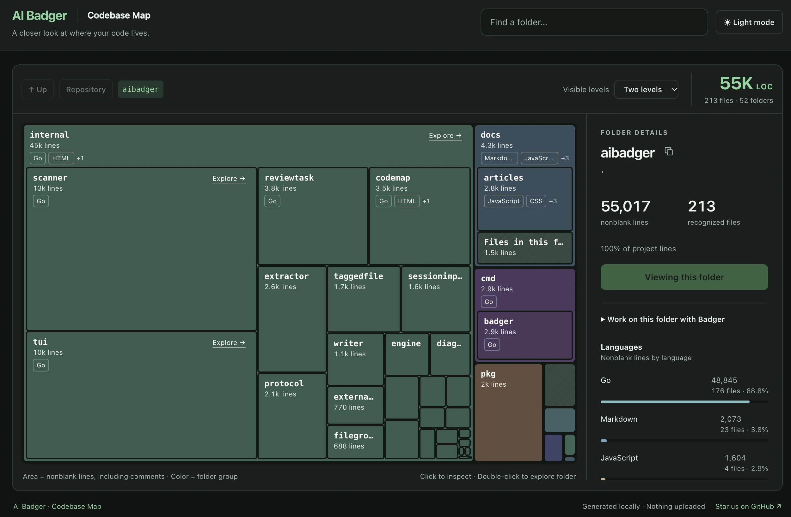

# Codebase Map

Codebase Map helps you see where code is concentrated and find a starting point
for a question or change. Generate one portable HTML report, then open it directly
from disk. No Git repository, provider configuration, server, or frontend runtime
is required.

[Try the live demo](https://pvrlabs.xyz/aibadger/codemap/) to explore a captured
map of the public AI Badger repository.



*The Badger codebase in dark mode. Rectangle area represents each folder's share
of raw nonblank source lines, including comments.*

## Generate and open a report

Map the current directory:

```sh
badger map
```

Or supply a directory:

```sh
badger map /path/to/project
```

The report is written to your current working directory as
`badger-codemap-<repo_name>.html`. After generation, Badger prints an open command
for your operating system. For example, on macOS:

```text
Generated codebase map HTML report.
Use the following command to open:
open -- '/path/to/badger-codemap-project.html'
```

Linux uses `xdg-open`; Windows prints a separately labeled PowerShell
`Invoke-Item` command. Run the command, or open the HTML file yourself.
Successful regeneration replaces an existing regular report. Generation failures
preserve it. Regenerate the report when you want to reflect source changes.

## Exclusions and regeneration

Add exclusions before or after the optional target:

```sh
badger map . --exclude 'vendor' --exclude 'public/assets/**' --exclude '**/*.min.js'
badger map ./src --exclude=generated --no-repro-command
badger map --exclude=-private -- -directory
```

Repeated patterns are additive; duplicates, overlaps and unmatched patterns are
valid. Use `--exclude=<pattern>` for values beginning with `-`. The `--`
delimiter permits a directory operand beginning with `-`.

Matching uses the same grammar as review, case-sensitively on every OS:

- Patterns without `/` match basenames at any depth. `vendor` matches a file
  or directory with that exact name; a matched directory prunes its subtree.
- Patterns with `/` are anchored at the **supplied mapped directory**, independently
  of the caller's working directory or Git root. `public/assets/**` matches the
  root subtree, including `public/assets` itself; `src/generated` prunes that
  directory without requiring a trailing `/**`.
- `*` matches zero or more characters within one component. Whole-component
  `**` matches zero or more components: `**/*.min.js` includes root-level files.
- Use `/` on Windows too. Empty patterns/components, `.`/`..` components,
  trailing slashes, absolute POSIX/Windows paths (including `C:foo` and UNC),
  control characters, `?`, brackets, backslashes and embedded `**` are rejected.
  Other punctuation is literal, including spaces, apostrophes, `$`, `;`,
  parentheses, braces and `!`. There is no regex, negation or escape syntax.
  Quote patterns for your shell; Badger preserves their text without trimming.

Built-in exclusions remain additive. Matching directories are pruned before
descent and depth/directory limits; matching files are skipped before file/byte
limits and reading. Removing all recognized nonblank source still fails and
preserves an existing report.

With user-provided exclusions, the report shows a subtle **Exclusions applied**
control after the breadcrumb in the navigation toolbar, above the map.
Its instructions expand below the controls without moving the button.
Expand it to reveal and copy the canonical regeneration command,
labeled POSIX on Unix or PowerShell on Windows. It preserves pattern order,
duplicates and literal characters. Copying happens only on click; if clipboard
access is unavailable, the command is selected for manual copying. Without user
exclusions, there is no indicator, regeneration section or command.

**Privacy:** relative exclusion patterns are embedded by default, including
unmatched patterns and names of excluded paths absent from the map. They may
expose sensitive repository names. `--no-repro-command` removes the indicator,
section, command and exclusion metadata entirely from the HTML; it affects
presentation only. Existing report paths, counts and filename lists remain
embedded. Generator version may remain as ordinary provenance.

Run the command from the **mapped directory** (the repository root only when
the whole repository was mapped). Its target is always `.`: mapping `repo/src`
must be replayed from `repo/src`, not `repo`. Equivalent counts require the same
source tree, Badger version and settings. Version identifies the generator; it
does not install or pin an executable. Byte-identical output is not promised.

The current working directory controls output placement, and only the destination
report is automatically omitted. Replaying from the mapped root may count an old
report left in a nested caller directory, or omit a different existing destination.
Remove or explicitly exclude stale report files when equivalent counts matter.

## Read and explore the map

- **Area shows code concentration.** Counts are raw nonblank physical lines,
  including comments. They do not measure complexity or recommend an AI context size.
- **Click a folder to inspect it.** Details show exact line and file totals,
  language proportions, subfolders, and the largest direct files.
- **Use Explore → to drill down.** Larger folder tiles include this link;
  the details panel also has an Explore folder action. Double-click is a shortcut.
  Use breadcrumbs, Up, or Repository to return.
- **Search finds folders across the repository.** Visible-level controls change
  nesting; small regions stay compact to keep the map readable.
- **Files in this folder represents direct files.** Its totals exclude subfolders.
  Individual files are listed in details rather than drawn as rectangles.
- **Colors distinguish folder branches.** Language chips and detail bars use their
  own colors. Switch between dark and light mode with the header control.

A folder without subfolders containing nonblank source gets a summary view when
explored. Spacious terminal tiles show exact totals, their share of lines in the
current view, and the top language percentages. Direct-file lists initially show
up to 20 entries and can expand to the largest 50.

## Start a focused Badger task

Expand **Work on this folder with Badger** in the details panel to copy a startup
command and a Design / exploration or Review task. Run `badger` for Design
(the default) or `badger review` to review Git changes from the repository root,
then paste the task into Badger's goal editor.
Copy Prompt 1 into your AI chat. The review may finish with findings from that
initial prompt. Only if the AI requests files, paste its response into Badger
and copy Prompt 2 back to the same chat for additional context.

The selected folder is a starting point. Review includes repository-wide Git
changes unless separately restricted; selecting a folder in the map only guides
review attention. Related files elsewhere may still be needed, and the report
itself contains metadata rather than source context.
The standalone report is separate from Badger's interactive Map → Extract → Apply
workflow. See the [Quick Start](../README.md#quick-start) for the full workflow.

Prefer working in your IDE? Use the [Badger VS Code companion](https://marketplace.visualstudio.com/items?itemName=pvrlabs.ai-badger).
See the [VS Code review walkthrough](https://pvrlabs.xyz/articles/reviewing-ai-generated-code-vscode-aibadger.html) for an example.

## Supported languages and extensions

Codemap recognizes source files by filename, without parsing their contents.
Basenames are matched case-insensitively on every OS at any directory depth.
Exact build basenames take precedence, followed by the compound suffix
`.blade.php`, then the final extension. Thus `.GO` and `.go` both count as Go.

Templates count as whole files, including embedded languages: `home.blade.php`
counts once as Blade, while ordinary `.php` stays PHP. The final template
suffix wins: `page.html.twig` is Twig and `config.yaml.j2` is Jinja, but
`page.jinja.html` remains HTML. Plain HTML stays HTML regardless of content or
location. PowerShell `.psd1` manifests/data count as PowerShell too.
All formats use raw nonblank physical lines, including comments; blank
recognized files still count as files. No encoding conversion is performed.

Only the exact build basenames below are special. Variants such as
`Dockerfile.dev`, `Makefile.am`, `Makefile.in`, `GNUmakefile`, and
`Justfile.local` remain unrecognized unless their final extension is already
supported (`Dockerfile.sh` counts as Shell).

Configuration formats also contribute to file counts, nonblank line totals, and
folder sizes. Web app manifests (`.webmanifest`) are counted as JSON; `.conf`
files use the Config label.

| Language | Extensions or exact basenames | Excluded files |
| --- | --- | --- |
| ABAP | `.abap` | — |
| Ada | `.ads`, `.adb`, `.ada` | — |
| Astro | `.astro` | — |
| Batch | `.bat`, `.cmd` | — |
| Blade | `.blade.php` | — |
| C | `.c` | — |
| C# | `.cs` | — |
| C++ | `.cc`, `.cpp`, `.cxx`, `.hh`, `.hpp`, `.hxx` | — |
| C/C++ | `.h` | — |
| Clojure | `.clj` | — |
| ClojureScript | `.cljs` | — |
| CMake | `.cmake`, exact `CMakeLists.txt` | — |
| COBOL | `.cbl`, `.cob`, `.cobol`, `.ccp`, `.cpy` | — |
| Config | `.conf` | — |
| CSS | `.css` | — |
| Dart | `.dart` | — |
| Dockerfile | exact `Dockerfile` | — |
| Elixir | `.ex`, `.exs` | — |
| Erlang | `.erl`, `.hrl` | — |
| F# | `.fs`, `.fsx` | — |
| Fortran | `.f77`, `.f90`, `.f95`, `.f03`, `.f08`, `.fpp`, `.ftn` | — |
| Go | `.go` | — |
| GraphQL | `.graphql`, `.gql` | — |
| Groovy | `.groovy`, `.gradle` | — |
| Haskell | `.hs`, `.lhs` | — |
| HTML | `.html`, `.htm` | — |
| IBM CL | `.clle`, `.clp`, `.clp38` | — |
| INI | `.ini` | — |
| Java | `.java` | — |
| JavaScript | `.js`, `.mjs`, `.cjs`, `.jsx` | — |
| JCL | `.jcl` | — |
| Jinja | `.jinja`, `.jinja2`, `.j2` | — |
| JSON | `.json`, `.webmanifest` | `package-lock.json` |
| Just | exact `Justfile` | — |
| Kotlin | `.kt`, `.kts` | — |
| Lua | `.lua` | — |
| Makefile | exact `Makefile` | — |
| Markdown | `.md`, `.markdown`, `.mdx` | — |
| Objective-C | `.m` | — |
| Objective-C++ | `.mm` | — |
| Perl | `.pl`, `.pm` | — |
| PHP | `.php` | — |
| PL/I | `.pli`, `.pl1` | — |
| PowerShell | `.ps1`, `.psm1`, `.psd1` | — |
| Properties | `.properties` | — |
| Protocol Buffers | `.proto` | — |
| Python | `.py`, `.pyw` | — |
| R | `.r` | — |
| RPG | `.rpgle`, `.sqlrpgle`, `.rpgleinc`, `.sqlrpg` | — |
| Ruby | `.rb` | — |
| Rust | `.rs` | — |
| Sass | `.sass` | — |
| Scala | `.scala`, `.sc` | — |
| SCSS | `.scss` | — |
| Shell | `.sh`, `.bash`, `.zsh`, `.fish` | — |
| Solidity | `.sol` | — |
| SQL | `.sql` | — |
| Svelte | `.svelte` | — |
| Swift | `.swift` | — |
| SystemVerilog | `.sv`, `.svh` | — |
| Terraform | `.tf` | — |
| TOML | `.toml` | — |
| Twig | `.twig` | — |
| TypeScript | `.ts`, `.mts`, `.cts`, `.tsx` | — |
| VHDL | `.vhd`, `.vhdl` | — |
| Visual Basic | `.vb` | — |
| Vue | `.vue` | — |
| XML | `.xml` | — |
| YAML | `.yaml`, `.yml` | `pnpm-lock.yaml` |
| Zig | `.zig` | — |

Excluded filenames in the table are matched by exact basename, case-insensitively
at any depth, before file quotas and per-file size limits. Ordinary JSON/YAML
files and names such as `custom-package-lock.json` remain eligible.

## Excluded files and directories

The following entries do not contribute to line totals, file counts, or map area:

- **Unrecognized filenames**, including generic `.txt` files (except
  `CMakeLists.txt`) and extensionless files other than the exact build basenames
  listed above.
- **Generated dependency lockfiles** listed in the table above.
- **Skipped directories and their contents**, listed below. Exact directory
  names are matched case-sensitively at any depth below the supplied root.
- **Symlinks and other non-regular files**. Symlinks are not followed; a supplied
  symlink root is rejected.
- **The destination HTML report**, when it is inside the scanned source tree.
  Other HTML files, including reports with different filenames, remain eligible.

| Category | Skipped directory names |
| --- | --- |
| Version control | `.git`, `.hg`, `.svn` |
| Editors | `.idea`, `.vscode` |
| Dependencies and environments | `bower_components`, `node_modules`, `vendor`, `.venv`, `venv`, `.tox`, `.nox` |
| Build output and coverage | `build`, `coverage`, `dist`, `obj`, `out`, `target` |
| Framework and tool caches | `.gradle`, `.next`, `.nuxt`, `.svelte-kit`, `.terraform`, `__pycache__` |

Directories named `bin` and near matches such as `build_tools` remain eligible.
Blank recognized files still count toward file totals, even when their folders
have no visible map area.

## Local generation and limits

Generate and explore the report offline, with no uploads or telemetry.
The HTML embeds relative paths,
aggregate metadata, and bounded filename lists; it does not embed source contents.
There are no external scripts, fonts, uploads, or automatic browser launches.
Documentation and product links open only when you choose them. Share the report
only if you intend to share its folder names, filenames, and counts.

See [Verify AI Badger's Local-Only Operation](network-verification.md) for the
CLI source inspection and its scope, including network-backed filesystem and
external-program limitations.

Hard limits are depth 50 below root, 20,000 directories including root,
100,000 recognized files, 50 MiB per source file, and 20 MiB for the complete HTML.
Invalid, unreadable, empty-source, or over-limit inputs fail without publishing a
partial report. Run `badger map --help` for command help.
